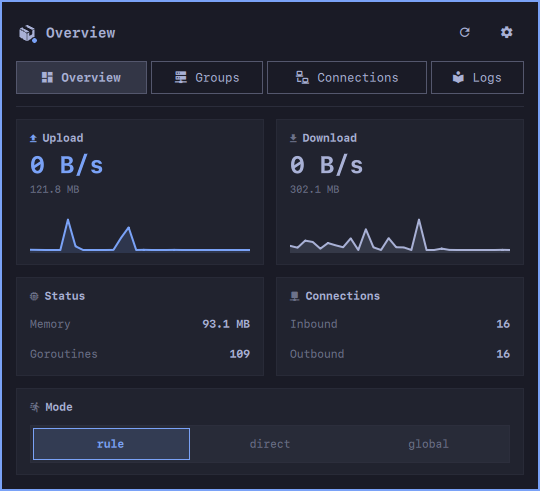
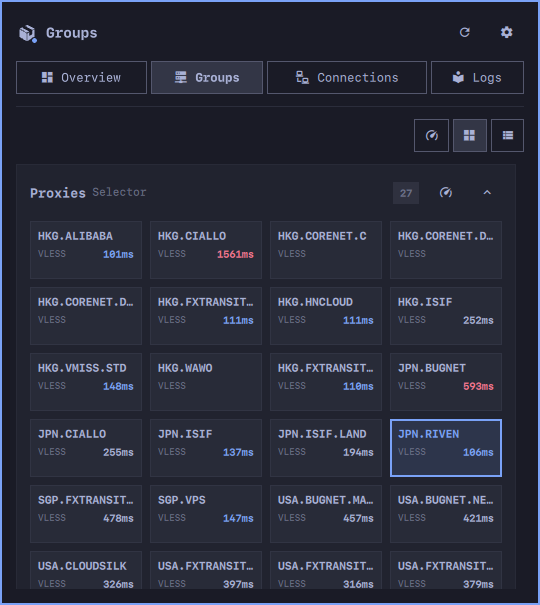
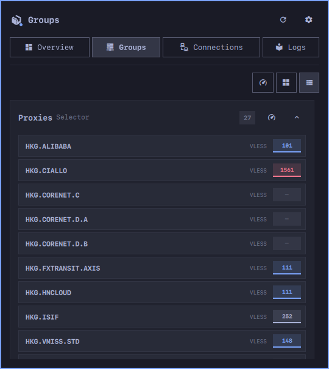
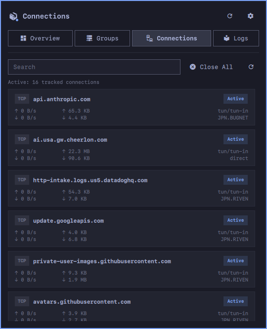
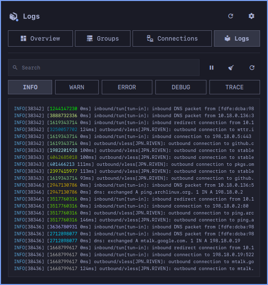
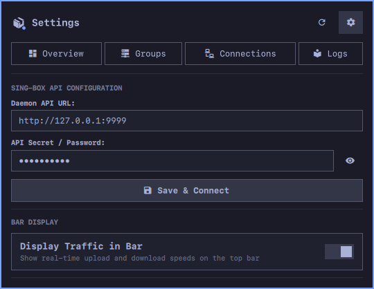

# sbdbar (sing-box dashboard bar widget)

A native [Omarchy](https://omarchy.org/) status bar widget and full-featured control panel for [sing-box](https://sing-box.sagernet.org/) (sing-box 1.14+), talking to sing-box through its daemon gRPC API.

Built following the official sing-box dashboard design language and Omarchy shell plugin standards.

| Overview | Groups (card view) | Groups (list view) |
| --- | --- | --- |
|  |  |  |

| Connections | Logs | Settings |
| --- | --- | --- |
|  |  |  |


## Features

- **Live Status Bar Monitoring**:
  - Real-time uplink & downlink throughput rates (`↑ 1.7 KB/s  ↓ 8.0 KB/s`).
  - Online/Offline/Unauthorized status indicator dot.
  - Native monochrome vector icon matching Omarchy bar theme styling.
  - Hover tooltip with active routing mode, active node, and detailed traffic.
- **Overview Tab**:
  - Routing mode selector pills: `Rule` | `Direct` | `Global`.
  - Metric cards: upload and download speed with totals and live sparklines, memory and goroutines, inbound and outbound connection counts.
- **Groups Tab**:
  - Collapsible group cards with type, node count and a per-group latency test; collapsed groups show a row of latency squares.
  - Card or list view for nodes, remembered across restarts, plus a "test all groups" button.
  - Nodes show protocol type and latency, colored by the theme (fast < 150ms, normal < 500ms, slow beyond). Results fill in live while a test runs, without redrawing the list.
  - One-click node selection.
- **Connections Tab**:
  - Live connection cards with host, protocol (`TCP`/`UDP`), inbound, outbound route, live rates and totals (`↑` / `↓`).
  - Search filter input to find connections by domain, IP, or outbound.
  - Individual connection close action button.
  - "Close All Connections" bulk action button.
- **Logs Tab**:
  - Real-time sing-box service logs viewer with ANSI color highlighting.
  - Log level filter: `INFO`, `WARN`, `ERROR`, `DEBUG`, `TRACE`.
  - Monospace styled console output with auto-scroll and pause controls.
- **Settings Tab**:
  - Configure the sing-box daemon API URL (default `http://127.0.0.1:9999`).
  - Configure API Secret / Bearer token with show/hide password toggle.
  - Toggle real-time traffic throughput display in the top bar.
  - "Save & Connect" with local persistence to `~/.config/sbdbar/config.json`.
- **Theme-aware styling**:
  - Every color derives from the current Omarchy theme (foreground, accent, urgent), so the panel follows theme switches; sing-box's own ANSI colors are kept in the logs.
- **gRPC Backend**:
  - A small Go helper, `sbdbar-agent`, subscribes to the sing-box daemon gRPC API (status, groups, mode, connections, logs) and pushes updates to the bar and panel as they happen, with no polling.
  - Node selection, URL tests, mode switching and closing connections are gRPC calls too.

## Dependencies

- **sing-box 1.14+** with the daemon API service enabled in its configuration:

  ```json
  "services": [
    { "type": "api", "listen": "127.0.0.1", "listen_port": 9999, "secret": "your-secret-token" }
  ]
  ```

  The Clash API (`experimental.clash_api`) is not used. For mode switching (`clash_mode` rules), security and troubleshooting, see [docs/sing-box.md](docs/sing-box.md).
- **`sbdbar-agent`**: the plugin's backend, built from `agent/` into `bin/sbdbar-agent`. It is not committed, so build it after installing (needs Go 1.25+):

  ```bash
  ~/.config/omarchy/plugins/sbdbar/scripts/build_agent.sh
  ```

  See `docs/grpc-agent.md` for details.

## Installation

### Method 1: Via Omarchy CLI (Git)

```bash
omarchy plugin add https://github.com/cheebun/omarchy-plugin-sbdbar --enable --yes
~/.config/omarchy/plugins/sbdbar/scripts/build_agent.sh
```

### Method 2: Manual Local Installation

Clone or copy the directory into `~/.config/omarchy/plugins/sbdbar`:

```bash
git clone https://github.com/cheebun/omarchy-plugin-sbdbar.git ~/.config/omarchy/plugins/sbdbar
~/.config/omarchy/plugins/sbdbar/scripts/build_agent.sh
omarchy plugin enable sbdbar
```

## Removal

To disable and remove the plugin:

```bash
omarchy plugin disable sbdbar
omarchy plugin remove sbdbar --yes
```

Or manually remove the installed directory:

```bash
rm -rf ~/.config/omarchy/plugins/sbdbar
```

## Configuration

Settings can be managed directly inside the panel's **Settings** tab.

Alternatively, declare overrides in `~/.config/omarchy/shell.json`:

```json
{
  "id": "sbdbar",
  "url": "http://127.0.0.1:9999",
  "password": "your-secret-token",
  "refreshIntervalSec": 2,
  "showTraffic": true
}
```

## IPC

The widget registers the IPC target `sbdbar`, so panel actions can be bound to keys:

```bash
qs ipc -p /usr/share/omarchy/shell call sbdbar toggle            # open/close the panel
qs ipc -p /usr/share/omarchy/shell call sbdbar openTab logs      # overview, groups, connections, logs, settings
qs ipc -p /usr/share/omarchy/shell call sbdbar setGroupsView list # card or list
qs ipc -p /usr/share/omarchy/shell call sbdbar toggleTraffic
qs ipc -p /usr/share/omarchy/shell call sbdbar refresh
```

## Validation

Verify that the plugin complies with Omarchy standards:

```bash
omarchy plugin validate .
(cd agent && go vet ./... && go test ./...)
qmllint -I /usr/share/omarchy/shell BarWidget.qml Panel.qml SingBoxIcon.qml
```

## License

[MIT](LICENSE)
